| | |
|:--|:--|
| <a href="https://bcodepr.com">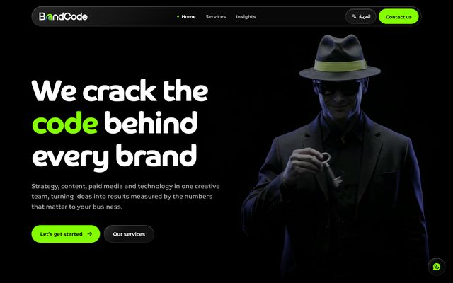</a> | **[bcodepr.com](https://bcodepr.com)** · BrandCode PR and marketing agency site with an admin panel for enquiries, articles and the team. `laravel` `react` `ssr` `sentry` |
| <a href="https://lucent-intl.com">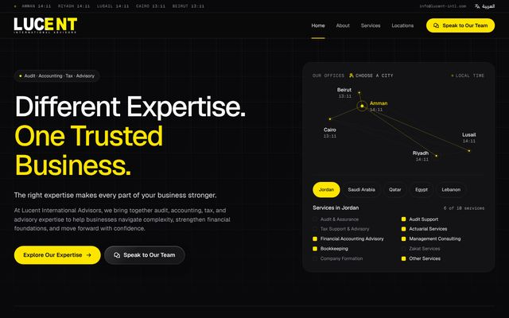</a> | **[lucent-intl.com](https://lucent-intl.com)** · Lucent International Advisors Audit and advisory firm in five countries, with an interactive offices map. `laravel` `react` `ssr` `seo` |
| <a href="https://canintlco.com">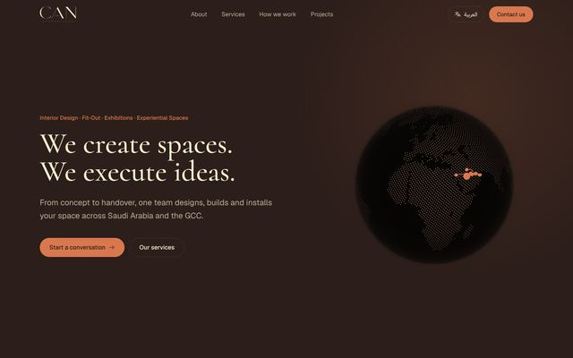</a> | **[canintlco.com](https://canintlco.com)** · CAN International Riyadh interior design, fit-out and exhibitions company, with a WebGL globe hero. `laravel` `react` `webgl` `motion` |
| <a href="https://retab.com.sa">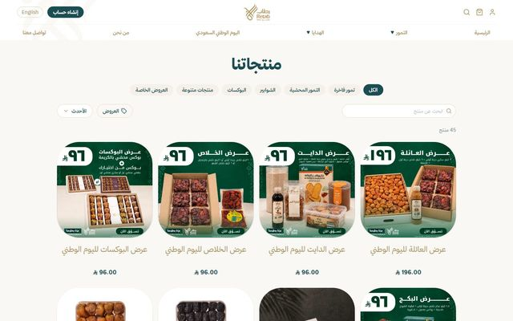</a> | **[retab.com.sa](https://retab.com.sa)** · Retab Stores Online store for a Saudi dates brand. Card, Apple Pay and Tamara checkout, OTO shipping. `laravel` `react` `playwright` |
| <a href="https://www.skyamman.com">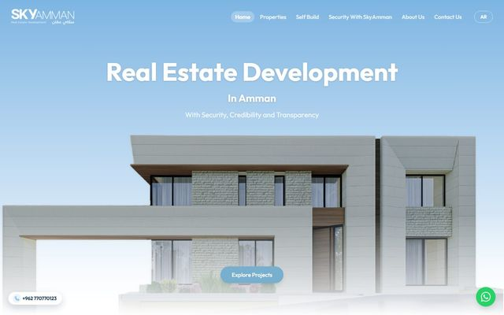</a> | **[skyamman.com](https://www.skyamman.com)** · Sky Amman Real estate developer site. Filterable listings, lead inbox, full CMS with undo. `laravel` `react` `ssr` |
| <a href="https://github.com/mercenary19961/showcase#nuor-steel">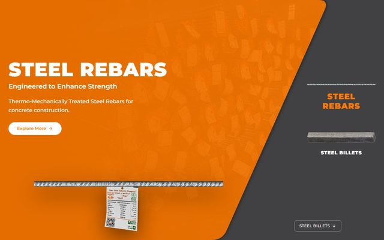</a> | **[nuor-steel/](https://github.com/mercenary19961/showcase#nuor-steel)** · Nuor Steel Saudi steel manufacturer. Spec sheets, certificate library, careers with CV upload. `laravel` `react` `sentry` |

Case studies and walkthrough videos: **[brandcode-showcase](https://github.com/mercenary19961/brandcode-showcase)** (BrandCode, Lucent, CAN International) and **[showcase](https://github.com/mercenary19961/showcase)** (Retab, Sky Amman, Nuor Steel, HardRock). Client code is private.

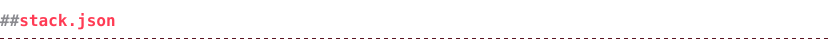

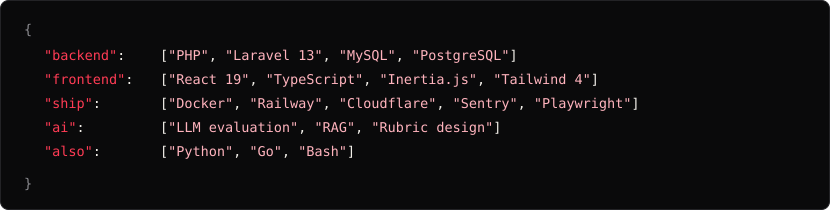

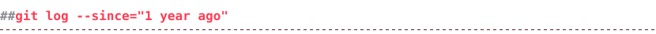


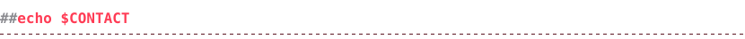

[linkedin](https://www.linkedin.com/in/zaid-sabbagh-6a7287227) · [portfolio](https://professional-portfolio-v2-dis2.vercel.app) · [showcase](https://github.com/mercenary19961/showcase) · [sabbaghzaid88@gmail.com](mailto:sabbaghzaid88@gmail.com)
